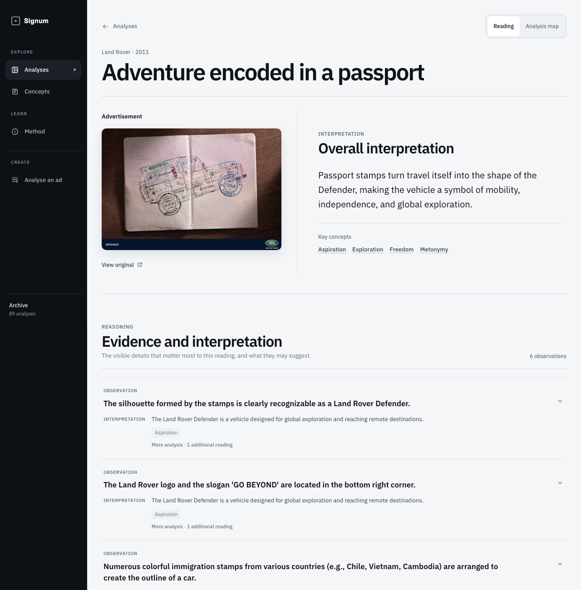

# Signum Decoder

**Reading advertisements the way Judith Williamson taught, with a vision model that runs on your own machine, and with every interpretation chained to something you can see.**

In _Decoding Advertisements_ (1978) Williamson argued that an advertisement does not simply describe a product. It borrows meaning from things we already value (freedom, nature, family, expertise, status) and transfers that meaning onto the product, and it quietly recruits the viewer to make the connection. The meaning is never stated; it is produced in the reader.

Signum applies that method to a corpus of real advertisements. A local vision-language model looks at each ad and produces a structured reading in three strictly separated layers:

1. **What the ad shows.** Visible details only: objects, people, text, layout, colour, logos. No meaning attached yet.
2. **What it may mean.** Interpretive claims about the message, the persuasion at work, the sign relations, and the audience being addressed.
3. **Why that fits.** Every claim points back to the specific visible details that support it, and names the analytical concepts it relies on from a controlled vocabulary.

Two rules hold everywhere in the system. An observation is never allowed to collapse into an interpretation. And an interpretation is a **contestable reading**, not a fact about the brand or its intentions. The point of exposing the evidence is so that you can disagree.



## What it does

- **An archive of decoded ads.** 97 case files covering 89 distinct advertisements (duplicate captures are merged into one archival identity), each with a machine-generated reading you can inspect layer by layer, plus a controlled vocabulary of 145 concepts (persuasion techniques, emotional levers, cultural codes, semiotic terms) with explanations and links back to the ads that use them.
- **A local decode pipeline.** Drop in a new ad image and the same pipeline asks the local model for a reading, validates the structured output against a strict contract, and admits it to the archive. Writes fail closed: a reading that does not validate is not stored.
- **A corpus model that keeps facts and readings apart.** Brand, year and provenance are archival facts with recorded sources. Readings are versioned revisions attached to the advertisement, so re-analysis adds history instead of overwriting it.

## One reading, as text

Land Rover Defender print ad (source recorded in [`cases/real-a-simple-brilliant-ad-by-land-rover-7ecb02ed/manifest.json`](cases/real-a-simple-brilliant-ad-by-land-rover-7ecb02ed/manifest.json)).

| Layer                | Content                                                                                                                                                                                                                                                                                                                           |
| -------------------- | --------------------------------------------------------------------------------------------------------------------------------------------------------------------------------------------------------------------------------------------------------------------------------------------------------------------------------- |
| **Observation**      | An open passport lies on a dark wooden surface. Colourful immigration stamps from many countries (Chile, Vietnam, Cambodia) are arranged so that together they form the outline of a car. The word DEFENDER sits bottom left; the Land Rover logo and "GO BEYOND" bottom right.                                                   |
| **Interpretation**   | The passport stands in for the traveller's life and experiences; the stamps stand for the places visited. By merging the car's shape with the travel documents, the ad implies the Defender is the essential tool for a life of adventure. The reader addressed is someone who values independence and going off the beaten path. |
| **Concepts invoked** | metonymy (semiotic), aspiration (persuasion technique), freedom (emotional lever), exploration (cultural code).                                                                                                                                                                                                                   |
| **How contestable**  | Each claim lists the observations it rests on and a confidence level. A reader who thinks the stamps are about status rather than freedom can see exactly which detail they are reading differently.                                                                                                                              |

The full record is in that case's `draft.json`: evidence records, claims, the evidence links between them, the concept references, and the raw model output that was mapped into the contract.

## Running it

Requirements: Node.js 22 or newer (`.nvmrc` pins 26), npm, and Python 3 with PyYAML for generating the glossary data.

```sh
npm ci
pip install pyyaml          # or your package manager's python3-yaml
bash scripts/doctor         # read-only environment check
```

### Browse the archive

```sh
npm run frontend:dev        # builds the data projection, then starts the Svelte dev server
```

Open the printed `http://127.0.0.1:5173` address. The archive, the concept glossary and the method page work entirely from the files in this repository. No model is needed.

### Tests and the full gate (mock model, no GPU)

```sh
npm test                    # unit and integration tests; the model is a deterministic mock
bash scripts/validate       # the same gate CI runs: docs, lint, types, tests, corpus checks, Svelte build, audit
```

The test suite drives the decode pipeline and the HTTP server with the mock adapter in `src/providers/mock-model-client.ts`. Nothing in the gate needs a model server.

### Decode a new ad with a local model

Real decoding uses any OpenAI-compatible vision endpoint. The project was developed against [llama.cpp](https://github.com/ggml-org/llama.cpp) behind [llama-swap](https://github.com/mostlygeek/llama-swap) with a Qwen3.8 27B vision model exposed as the `signum-vision` profile. Set the endpoint and model if yours differ:

```sh
export SIGNUM_DECODE_BASE_URL=http://127.0.0.1:8082   # default
export SIGNUM_DECODE_MODEL=signum-vision              # default
npm run decode:server                                 # loopback-only HTTP adapter on 127.0.0.1:5174
```

Then use the **Analyse an ad** page in the frontend, or post an image to `/api/decode`. To try the same path without a model, start the server with the mock adapter:

```sh
SIGNUM_DECODE_PROVIDER=mock npm run decode:server
```

All runtime variables are documented in `.env.example`. The server binds to loopback and is not designed to be exposed to the Internet.

## Architecture

| Part                  | Where                                                      | Responsibility                                                                                       |
| --------------------- | ---------------------------------------------------------- | ---------------------------------------------------------------------------------------------------- |
| Decode contract       | `src/contracts/decode-draft-v1.ts`, `src/validation/`      | The structured shape of a reading and the integrity rules a new reading must pass                    |
| Model seam            | `src/providers/`                                           | `ModelClient` interface; llama-server adapter and deterministic mock behind it                       |
| Decode module         | `src/decode/`                                              | Upload and batch orchestration: image constraints, model call, mapping, validation, admission        |
| Case Library          | `src/cases/`                                               | One directory per ad under `cases/`: image, source manifest, reading                                 |
| Corpus Store          | `src/corpus/`                                              | Archival identity, brand/time facts with provenance, versioned decode revisions, typed relationships |
| Controlled vocabulary | `content/`, `src/reference-vocabulary/`, `src/references/` | The governed concept families a claim may reference; the ontology and glossary sources               |
| Source adapters       | `src/ingest/`, `src/acquisition/`                          | Reddit r/AdPorn, Meta Ad Library and Wikimedia Commons acquisition with recorded provenance          |
| Frontend              | `frontend/`                                                | Svelte 5 / SvelteKit static site: archive, case reading, concepts, method, analyse                   |
| Local HTTP adapter    | `src/server/`                                              | Thin loopback server over the Decode module for the analyse page                                     |

`ARCHITECTURE.md` is the fast map. `docs/architecture/MINIMUM-BACKBONE.md` holds the invariants, `docs/product/system/` the product and analysis model, and `docs/adr/` the decisions that got here, including the one that removed a human review step so that the machine reading is the thing on display, warts included. `AGENTS.md` is the operating guide the project uses for coding agents; it is kept public because the discipline it describes is part of how this was built.

## Limits and ethics

- **Readings are not facts.** They are one model's interpretation under one method. Confidence values describe how well the visible evidence supports a claim, not whether the claim is true. Signum never asserts what an advertiser actually intended.
- **The method has a point of view.** Williamson's framework is a critical one. It is good at surfacing how meaning is transferred and who is being addressed; it is not a neutral measurement of advertising effectiveness.
- **One model, one pass.** Readings were generated by a single local model. Alternative readings and re-analysis are supported by the corpus model but the published archive is not a consensus.
- **Keep it local.** The decode server is a loopback development tool. Model output is treated as untrusted input and validated before anything is written.
- **No affiliation.** Signum is independent. It is not affiliated with, sponsored by or endorsed by any brand or advertiser in the corpus, nor by Judith Williamson or her publisher.

## Third-party content

The images under `cases/` are advertisements made by their respective brands and agencies. They are reproduced, unmodified, as the object of non-commercial research and commentary, and each is accompanied by a structured critical reading that cannot be checked without the image. Every image's public source URL and SHA-256 checksum are recorded in its `manifest.json`. See [`cases/README.md`](cases/README.md).

Rights holders who want an advertisement removed can open an issue naming the case directory or source URL, or use the private route in `SECURITY.md`. Requests are actioned promptly and without discussion.

## Licence

Code and project documentation are released under the [MIT License](LICENSE). The licence does not cover the advertisement images, which remain the property of their rights holders.
